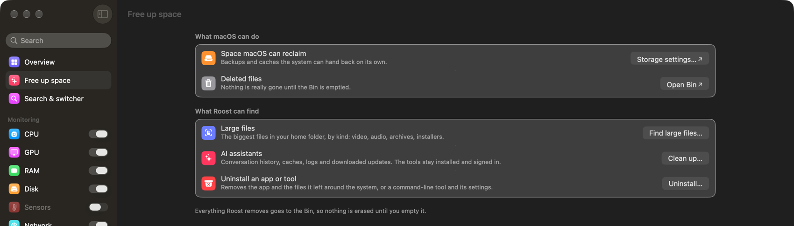

<p align="center">
  
</p>

<h1 align="center">Roost</h1>

<p align="center">
  <strong>Switch apps, watch your Mac, and free up space — from the menu bar.</strong>
</p>

<p align="center">
  <a href="https://github.com/sagardn/Roost/releases/latest"></a>
  
  <a href="LICENSE"></a>
</p>

Roost is a free, native macOS app that lives in your menu bar. It opens and
switches apps from the keyboard, shows how hard your Mac is working, keeps a
clipboard history, and helps you find what is filling your disk. No account,
no analytics, no Dock icon.

*Roost was called Perch until version 1.0.19.*

<p align="center">
  
  <br><em>The Overview: every reading in one window, with battery health on laptops.</em>
</p>

## Install

Paste this into Terminal:

```bash
curl -fsSL https://raw.githubusercontent.com/sagardn/Roost/main/Tools/install.sh | bash
```

It downloads the [latest release](https://github.com/sagardn/Roost/releases/latest),
installs Roost in `/Applications` and opens it. If you had Perch, it is
replaced and your settings come across.

- **Requires macOS 14 Sonoma or newer.**
- Allow **Accessibility** when asked (System Settings → Privacy & Security →
  Accessibility). Roost needs it to move, minimise and restore windows.
- Updates install themselves; Roost checks once a day.

Why a Terminal command? Roost is free and not notarised by Apple, so macOS
blocks it when it is downloaded in a browser. The [User Manual](docs/USER_MANUAL.md#installing)
explains this and how to open a browser download instead.

## Features

<table>
  <tr>
    <td width="50%" valign="top">
      <h3>App launcher and switcher</h3>
      Press <code>⌃Space</code>, type a few letters, press Return. Roost
      opens the app, brings it forward, or minimises it if it is already in
      front. It also does quick sums and unit conversions, cycles your
      favourite apps with <code>⌃Tab</code>, and snaps windows to halves
      and quarters.
    </td>
    <td width="50%" valign="top">
      <h3>System monitor</h3>
      CPU, GPU, Memory, Disk, Network and Sensors, each as a live reading in
      the menu bar. Click one for a popup with a chart, details and the apps
      using the most. Right-click an app there to quit it.
    </td>
  </tr>
  <tr>
    <td width="50%" valign="top">
      <h3>Menu bar readings and alerts</h3>
      Readings are coloured by load: teal when calm, amber when busy, red when
      something needs you. Choose from nine shapes, or combine modules into one
      item. Get notified when a reading crosses your limit, or when one app has
      kept the CPU busy for minutes.
    </td>
    <td width="50%" valign="top">
      <h3>Overview and battery health</h3>
      One window with a plain-language summary of your Mac, a card per module,
      and battery health (capacity, cycle count, charge) on laptops. Reorder or
      hide cards with <strong>Customize</strong>.
    </td>
  </tr>
  <tr>
    <td width="50%" valign="top">
      <h3>Clipboard history</h3>
      Keeps text, links, files and images you copy, with search, filters and
      pinning. Pick an entry to copy it again, or let Roost paste it for you.
      Off until you turn it on.
    </td>
    <td width="50%" valign="top">
      <h3>Free up space</h3>
      Find large files, uninstall apps together with the files they leave
      behind, remove command-line tools, and clear caches and old downloads
      from AI assistants. Everything goes to the Bin, never straight to
      deletion.
    </td>
  </tr>
</table>

<p align="center">
  
  <br><em>Menu bar readings, coloured by load. The red bar is a disk that is filling up.</em>
</p>

<table>
  <tr>
    <td width="40%" valign="top" align="center">
      
      <br><em>⌃Space search. Dots mark running apps.</em>
    </td>
    <td width="60%" valign="top" align="center">
      
      <br><em>Clipboard history settings.</em>
    </td>
  </tr>
</table>

<p align="center">
  
  <br><em>Free up space: what macOS can reclaim, and what Roost can find.</em>
</p>

## Keyboard shortcuts

| Shortcut | Action |
|---|---|
| `⌃Space` | Open the search panel |
| `⌃Tab` | Cycle your marked apps |
| `⌃1` … `⌃9` | Jump to a pinned app |
| `` ⌃` `` | Minimise the front app; press again to restore |
| `⌃⌥←` `⌃⌥→` | Snap the window to the left or right half |

The [full list](docs/USER_MANUAL.md#keyboard-shortcuts), including window
snapping and the keys inside the search panel, is in the manual.

## Privacy

- **Nothing is collected.** No analytics, crash reporting or account.
- **Network use is limited and listed:** a daily update check against GitHub,
  a connection test to `1.1.1.1` while the Network popup is open, and your
  public IP from `ifconfig.co` (on by default; turn it off in the Network
  settings).
- **Clipboard history** stays on your Mac, unencrypted, in
  `~/Library/Application Support/Roost/`. Copies that apps mark as private,
  such as passwords from a password manager, are never kept.
- **Permissions:** Accessibility for window control, and Location only if you
  ask to see your Wi-Fi network's name. Roost never asks for Full Disk Access.

Details are in the manual's [Privacy](docs/USER_MANUAL.md#privacy) section.

## Documentation

- [User Manual](docs/USER_MANUAL.md): every feature, setting and shortcut,
  plus [troubleshooting](docs/USER_MANUAL.md#troubleshooting) and
  [uninstalling](docs/USER_MANUAL.md#uninstalling).
- [Architecture](docs/ARCHITECTURE.md): how the code is organised.
- [Contributing](CONTRIBUTING.md): how to send a change.

Found a bug? Click the bug button at the bottom of Roost's Settings window. It
copies a diagnostics report and opens a new
[issue](https://github.com/sagardn/Roost/issues/new).

## Support

Roost is free. If it helps you, you can [buy me a coffee on Ko-fi](https://ko-fi.com/sagardn)
or star the repository.

<p align="center">
  <a href="LICENSE">MIT</a> © 2026 Sagar
</p>
